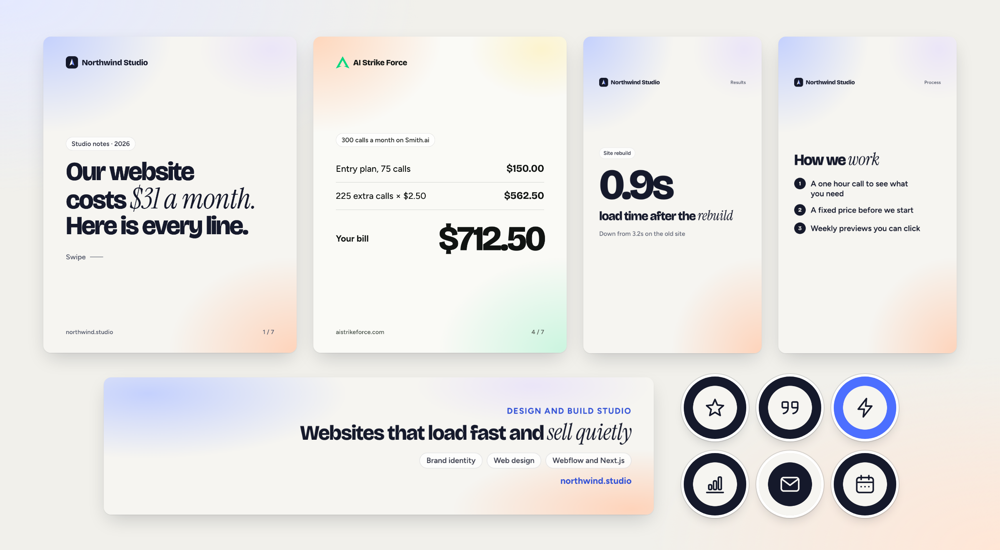
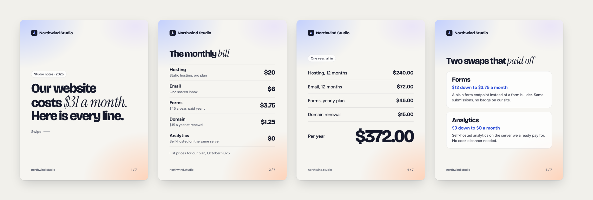
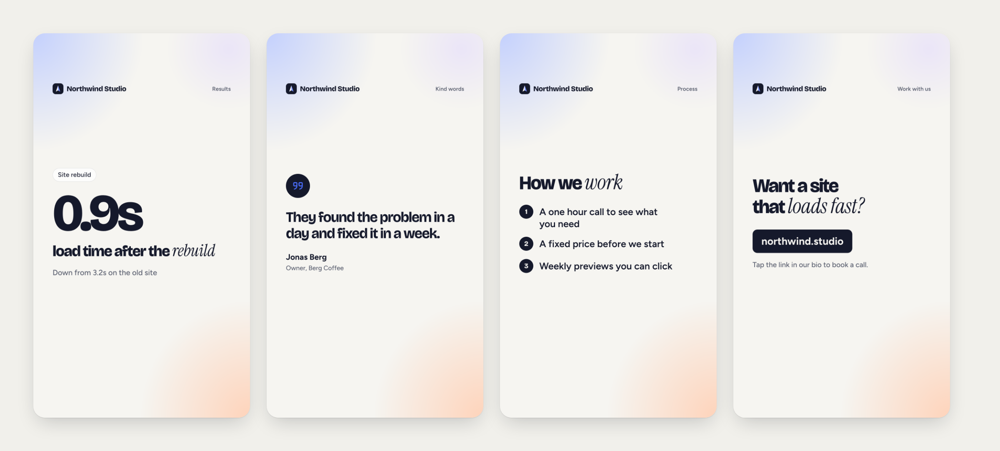
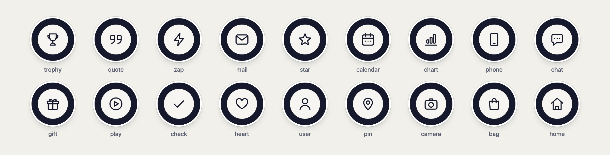
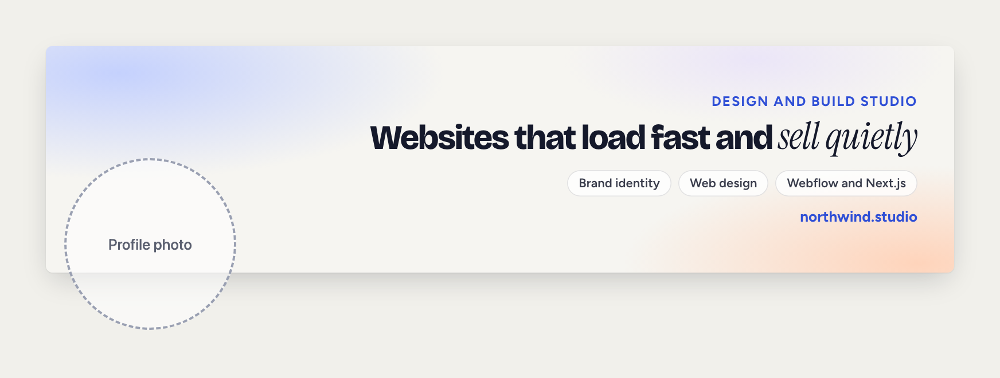
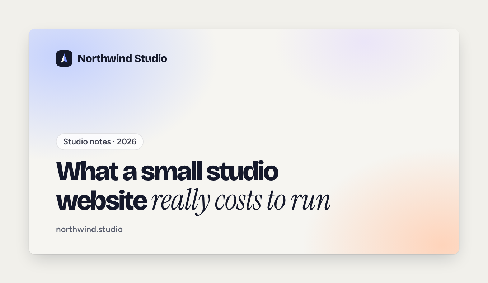
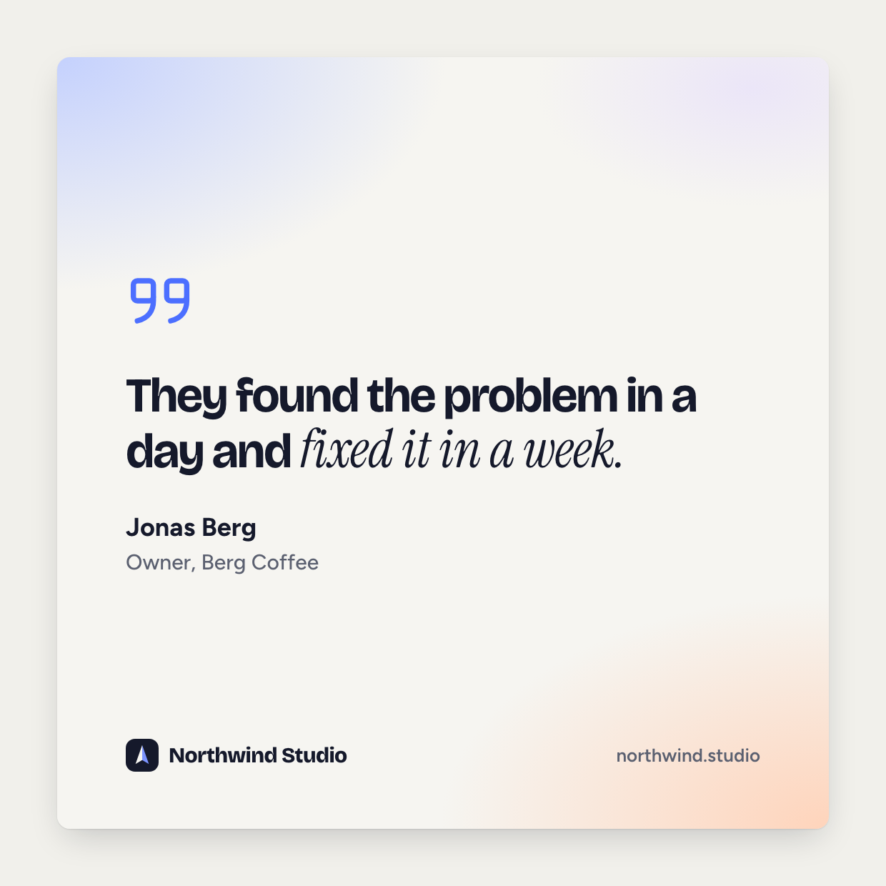
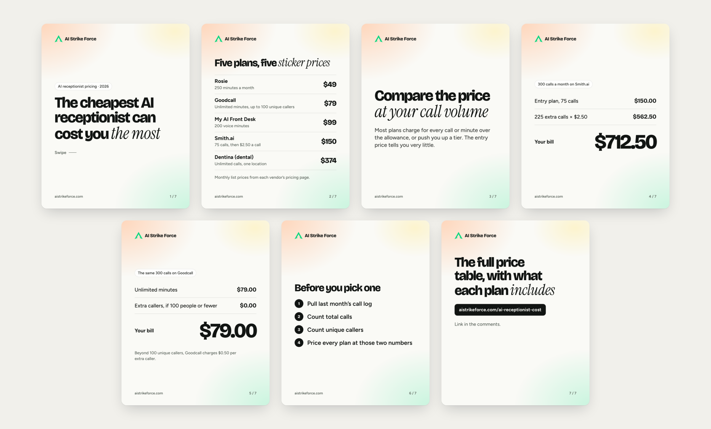

<p align="center"></p>

# social-kit

Your logo, your colours, your fonts and a few lines of text in. LinkedIn carousels, Instagram stories and highlight covers, a LinkedIn banner, share cards and quote cards out. Rendered by the Chrome you already have.

```
/plugin marketplace add oussch702/social-kit
```

Then `/plugin install social-kit@social-kit`, and ask Claude Code for a carousel.

No design tool, no SaaS, no API keys, no npm dependencies.

## What you get

**LinkedIn document carousel.** 1080×1350 slides as PNGs plus one PDF ready to upload as a document post. Seven slide types: cover, statement, price table, line-item math with a big total, checklist, cards and a call to action.



**Instagram story sets.** 1080×1920, with nothing important in the top 250px or bottom 330px where Instagram draws the progress bar and the reply box. Four types: stat, quote, list and call to action.



**Instagram highlight covers.** 1080×1920 with the icon centred in the circle Instagram shows. 18 built-in icons drawn for this project, three styles, or your own SVG.



**LinkedIn profile banner.** 1584×396, right aligned so the left 420px stay clear for your profile photo.



**Open Graph share card** (1200×630) and **quote card** (1080×1080).

<p> </p>

## Quick start

You need Node 22 or newer and Chrome, Chromium or Edge.

```
git clone https://github.com/oussch702/social-kit && cd social-kit
node bin/social-kit.mjs init my-brand
node bin/social-kit.mjs render my-brand/spec.json --out my-brand/out
```

`init` writes a starter `brand.json`, `spec.json`, logo and fonts. Edit them, render again, and open `my-brand/out/contact-sheet.png` to see every image at once.

Other commands: `check spec.json` validates without rendering, `contact-sheet <folder>` tiles any folder of PNGs, `icons` lists the built-in icons.

## Use it from Claude Code

```
/plugin marketplace add oussch702/social-kit
/plugin install social-kit@social-kit
```

Then ask in plain words: "Make a 6-slide LinkedIn carousel from this blog post", "Highlight covers for Reviews, Offers and FAQ", "A banner that says what we do". The skill collects your brand, writes the spec, renders, then opens the contact sheet and fixes any slide where the text is cramped before it hands the files over.

The skill is a plain `SKILL.md` in `skills/social-kit/`, so any coding agent that can run Node can follow it.

## Brand config

```json
{
  "name": "Northwind Studio",
  "url": "northwind.studio",
  "logo": "./logo.svg",
  "colors": { "bg": "#f6f5f1", "ink": "#15192b", "muted": "#5b6070", "accent": "#4c6fff", "accentInk": "#2f4fd6" },
  "background": { "style": "glow", "colors": ["#bfcdff", "#ffd2b8", "#e0d6ff"] },
  "fonts": {
    "display": { "file": "./fonts/BricolageGrotesque.woff2", "family": "Bricolage Grotesque" },
    "body": { "file": "./fonts/Figtree.woff2", "family": "Figtree" },
    "accent": { "file": "./fonts/InstrumentSerif-Italic.woff2", "family": "Instrument Serif", "style": "italic" }
  }
}
```

| Field | What it does |
| --- | --- |
| `colors.bg`, `ink`, `muted` | Page, text and small grey text. `check` warns if the contrast is too low to read. |
| `colors.accent` | Bullets, highlight cover fills, the quote mark. |
| `colors.accentInk` | A darker accent for text on the page: banner kicker, card prices. |
| `background` | `"glow"` with up to three soft colours in the corners, or `"solid"`. |
| `fonts` | Display (headlines), body, and an italic serif for `*emphasis*`. Any local woff2, woff, ttf or otf. Leave out to use the bundled fonts. |
| `logo` | SVG, PNG, JPG or WebP. Set `"showName": false` if the logo already contains the name. |

A dark theme works too: give it a dark `bg` and a light `ink`.

## Spec reference

`spec.json` lists what to render. Every key except `brand` is optional, and `carousel`, `banner`, `og` and `quote` also accept a list. Text between `*asterisks*` is set in the italic serif.

| Asset | Type | Fields |
| --- | --- | --- |
| `carousel` | | `name`, `url` (for the last slide), `author` {`name`, `role`}, `slides` |
| | `cover` | `kicker`, `title`, `swipe` |
| | `statement` | `title`, `body` |
| | `rows` | `title`, `rows` [[label, value, detail]], `note` (up to 6 rows) |
| | `math` | `kicker` or `title`, `lines` [[label, amount]], `total` [label, amount], `note` |
| | `checklist` | `title`, `items`, `numbered` (false for square bullets), `note` |
| | `cards` | `title`, `cards` [[title, value, text]] (up to 3) |
| | `cta` | `title`, `link`, `hint`, `author` |
| `stories` | `stat` | `kicker`, `number`, `line`, `footnote`, `group` |
| | `quote` | `quote`, `name`, `role`, `group` |
| | `list` | `title`, `items` (up to 5), `group` |
| | `cta` | `title`, `link`, `hint`, `group` |
| `highlights` | | an icon name, or {`icon` or `svg`, `style`: ink, accent or light, `file`} |
| `banner` | | `kicker`, `title`, `chips` (up to 4), `url` |
| `og` | | `kicker`, `title`, `url` |
| `quote` | | `quote`, `name`, `role`, `url` |

Output goes to one folder: `<carousel name>/slide-01.png` and `<name>.pdf`, `stories/`, `highlights/`, `linkedin-banner.png`, `og.png`, `quote.png` and `contact-sheet.png`.

Headlines shrink step by step until they fit. If a page still overflows, `render` names the file and exits with code 2, so a script or an agent knows to shorten the text.

## A real deck

[`examples/ai-strike-force`](examples/ai-strike-force) is a real deck from our AI receptionist pricing guide. Every number comes from the vendors' own pricing pages.



## Why

- **Your brand, every time.** Colours, fonts and logo live in one file. Every image follows it, so nothing drifts off-brand.
- **Text in, images out.** Changing a price means changing one line of JSON, not reopening a design file.
- **Version controlled.** Specs are plain files. Review them in a pull request, keep them next to the blog post they promote.
- **Agent friendly.** A coding agent can write the spec, render it, look at the contact sheet and fix what it sees. No browser automation of a design app.
- **Nothing to sign up for.** It runs on your machine with the browser you already have.

## FAQ

**Can I use the bundled fonts commercially?** Yes. Bricolage Grotesque, Figtree and Instrument Serif are under the SIL Open Font License 1.1, which allows commercial use and embedding. The license texts are in [`fonts/`](fonts). The bundled files are Latin subsets; for other scripts, point `brand.json` at your own font files.

**Do I need Chrome?** Chrome, Chromium or Edge. social-kit looks in the usual places on macOS, Linux and Windows. Set `CHROME_PATH` to use a specific one, or another Chromium browser.

**Why Node 22?** It ships a built-in WebSocket, which social-kit uses to talk to Chrome. That is what keeps it at zero dependencies.

**Can I add my own layouts?** Each format is a small HTML and CSS function in [`src/templates.mjs`](src/templates.mjs). Copy one and change it.

**Does it work in CI?** Yes. The test in [`.github/workflows/test.yml`](.github/workflows/test.yml) renders the demo on Ubuntu and checks every image's pixel size and the PDF page count.

## Credits and license

Code under the [MIT License](LICENSE). Fonts under the SIL Open Font License 1.1, by their authors listed in [`fonts/`](fonts). The icons are original to this project and MIT licensed with the code.

---

Built by [AI Strike Force](https://aistrikeforce.com), a forward deployed AI team. We build the AI systems that grow revenue.
